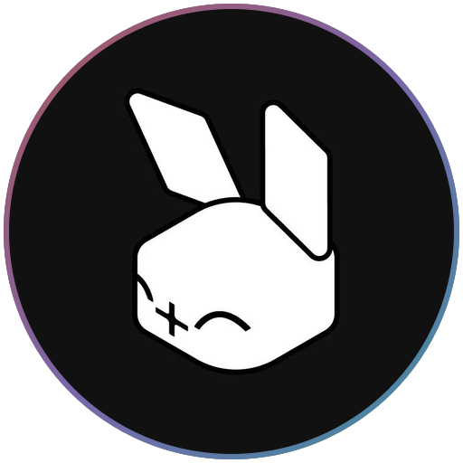
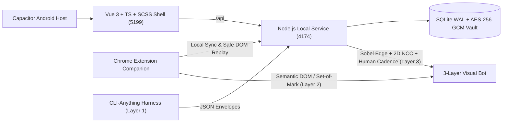

<div align="center">



# SOCIALKILLER

**Kill the social media agencies & middlemen. Keep 100% of your craft.**

*A local-first automated creative agency operating system—giving every creator, designer, writer, and builder the framework to run their own agency with zero middleman cut.*

<p>
  
  
  
  
  
</p>

[Manifesto](#-the-manifesto--why-we-built-this) · [Workspaces](#-13-mini-app-workspaces) · [Architecture](#-architecture--3-layer-visual-bot) · [Quick Start](#-quick-start) · [CLI & Visual Bot](#-cli--developer-tooling) · [Documentation](#-documentation--7-phase-roadmap)

</div>

---

## 🔥 The Manifesto — Why We Built This

The creative industry is broken because of extractive social media agencies and middlemen.

Every day, the creative people who do almost all the real work grind through sleepless nights shipping content, edits, scripts, and campaigns like laborers—while middlemen sleep, eat, and pass back barely **1% of the profit** to the workers who actually created the value.

**SOCIALKILLER brings the revolution.** Every creative person gets a complete, automated agency framework under their own control:

- **You own the ideation, voice, and creative craft.**
- **The app automates the middleman and social media manager operations**—multi-channel adaptation, scheduling queues, audience audits, engagement drafts, and browser workflow replay.

Creative workers are taking back 100% control for themselves. This is just the start. **Join our revolution.**

---

## ⚖️ Middleman Agency vs. SOCIALKILLER

| Dimension | Traditional Agency / Middleman | SOCIALKILLER |
|---|---|---|
| **Creative Margin** | Middleman keeps ~99%; workers receive ~1% | **100% retained by the creator / worker** |
| **Data & Credentials** | Locked in SaaS rent & agency accounts | **Local SQLite WAL + AES-256-GCM vault on your machine** |
| **Daily Operations** | Manual agency coordination & scattered spreadsheets | **13 unified mini-app workspaces + 3-Layer Visual Bot** |
| **Publishing Safety** | Opaque credential sharing & unreviewed handoffs | **Local-first drafts, explicit human approval & dry-run defaults** |

---

## 🧩 13 Mini-App Workspaces

SOCIALKILLER opens to one shared **Apps** launcher (`?app=<id>`). Selecting a workspace switches views in the same site and tab while keeping your active brand context, Global Search, and theme synced across every tool.

| Category | Workspace | Core Capability |
|---|---|---|
| **Plan & Publish** | **Planner** | Channel-specific post composer, clean TL;DR summarizer, drafts, approval queue, calendar/list views, and export/handoff |
| **Plan & Publish** | **Connections** | Per-brand channel configuration, encrypted credential checks, Meta OAuth linking, and account assignment |
| **Community & Audience** | **Engage** | Locally organized comments/messages and human-reviewed reply drafts |
| **Community & Audience** | **Audience Audit** | Local Instagram export (`.zip` / `.json`) analysis, follower diffs, categories, whitelist, account health, and safe queue |
| **Community & Audience** | **Profile Scout** | Public Instagram follower-count lookup and HD avatar download utility |
| **Create** | **Content Studio** | Curated short-form inspiration, caption variations, and viral/hook scoring |
| **Create** | **Script Studio** | Brand-aware 30s/60s/vlog video scripts and daily milestone story generators |
| **Operate** | **Workflows** | Review and manage brand-scoped browser workflows recorded via the Chrome extension companion |
| **Operate** | **Workspaces** | Multi-brand voice, reference links, Markdown knowledge docs, GitHub sync, and workspace switching |
| **Operate** | **Automation Studio** | Paused-by-default scheduled, manual, and social-post-triggered draft workflows with run logs & retry |
| **Build** | **Design System** | Dark-first & light glassmorphism themes, 5 accent palettes, and live component token preview |
| **Build** | **Asset Manager** | Local visual asset catalog, deterministic WebP variants, and catalog validation |
| **Build** | **Android Build Studio** | Local JDK/SDK inspection and fixed Capacitor debug APK / release AAB builds |

---

## ⚙️ Architecture & 3-Layer Visual Bot



- **Layer 1 — `CLI-Anything` JSON Harness (`<10ms`):** Deterministic JSON commands (`manifest`, `summarize`, `score`, `visual-bot`, `status`) for both creators and coding agents.
- **Layer 2 — Semantic DOM & Accessibility Bridge (`<50ms`):** Role/ARIA/test-id targeting and cached site locators inside the optional Chrome extension, excluding password and payment controls.
- **Layer 3 — Theme-Invariant Sobel Vision & Human Cadence (`<120ms`):** Zero-dependency Sobel gradient + 2D Normalized Cross-Correlation (`server/engine/vision-contour.mjs`) paired with Box-Muller log-normal cognitive delays.

---

## 🚀 Quick Start

```sh
npm install
npm run launch
```

Or double-click `Launch FoundryDesk.cmd` in the repository root. It starts and manages the local API on port `4174` and the dashboard on port `5199` (or a free fallback port).

> Legacy fallback launcher: [`launcher/launch-legacy.cmd`](./launcher/launch-legacy.cmd).

### Verify & Test

```sh
npm run type-check
npm run build
npm test
```

### 💻 CLI & Developer Tooling

```sh
npm run dev:doctor       # Full runtime, SQLite, Visual Bot & TypeScript health check
npm run cli-anything     # Emit agent-native CLI-Anything tool manifest (JSON)
npm run planning:check   # Validate UI/UX research register, docs freshness & modularity plan
```

---

<details>
<summary><strong>🛡️ Operating Boundaries, Meta Account Linking & Zuari UI Islands</strong></summary>

### Important Boundaries
- **Audience Privacy:** Follower and following identities come only from user-provided Instagram exports or user-initiated sync; public profile lookup attempts follower counts only.
- **Draft-First Safety:** Drafts require explicit human review. Direct publishing depends on channel configuration and explicit operator action.
- **Preview vs. Companion Replay:** Lua scripts are preview-only; website workflow recording and same-origin safe replay run explicitly through the Chrome extension companion.

### Meta Account Linking
Configure Meta linking per workspace from **Connections**:
1. Add `META_APP_ID`, `META_APP_SECRET`, and `http://127.0.0.1:4174/api/social/meta/callback` to `.env`, and register that callback in your Meta app's Facebook Login settings.
2. Set `FOLLOWDESK_VAULT_KEY` to a private key of at least 32 characters so OAuth tokens encrypt cleanly at rest.
3. The current flow requests `pages_show_list`, `pages_read_engagement`, `instagram_basic`, and `instagram_content_publish`. Direct Instagram publishing requires an Instagram professional account linked to the selected Facebook Page and an accessible public image or video URL; other posts route through Meta Business Suite handoff. Facebook Page direct publishing is not implemented yet.

### Zuari UI Pilot
- `ImportBanner` and `AudienceCategoryTabs` run as Vue-hosted `@zuari/dom` islands in light DOM while Vue owns state, lifecycle cleanup, and navigation.
- Release tarballs in `vendor/zuari` are wired via `file:` dependencies so `npm install` works standalone without the Zuari monorepo.

</details>

---

## 📚 Documentation & 7-Phase Roadmap

| Guide | Purpose |
|---|---|
| [Documentation Index](./docs/README.md) | Central sitemap across product, UX, engineering, and API specs |
| [Mini-App Architecture](./docs/product/MINI_APP_ARCHITECTURE.md) | Audited feature map across all 13 shipped workspaces and roadmap scope |
| [UX Guide](./docs/product/UX_GUIDE.md) | 4-Tier Animation architecture, Audience UX, glassmorphism & symbolic icon rules |
| [UI/UX Declutter & Efficiency Plan](./docs/product/UIUX_DECLUTTER_AND_EFFICIENCY_PLAN.md) | 16-surface clutter audit, dev supervisor & 3-Layer Visual Bot blueprint |
| [Backend Organization Plan](./docs/engineering/BACKEND_ORGANIZATION_PLAN.md) | Layered `server/http/`, `server/modules/`, `server/jobs/` & SQLite single-truth plan |
| [GitHub Toolkit Adoption Plan](./docs/research/GITHUB_TOOLKIT_ADOPTION_PLAN.md) | Selected MIT / Apache-2.0 / MPL-2.0 libraries mapped across phases |
| [7-Phase Implementation Roadmap](./docs/product/uiux/planning/ROADMAP.md) | Phased execution tracker (`phase-1-shell-audience` → `phase-7-modularity-release`) |

---

<div align="center">

**Join the revolution. Own your craft. Keep 100%.**

</div>
