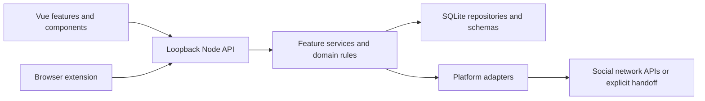

# Architecture overview

The Social Base is a local-first modular monolith. The desktop app is Vue 3 + TypeScript + Vite, wrapped with Capacitor where needed. A loopback Node.js API owns business rules, SQLite persistence, background scheduling and platform adapters. The browser extension is a separate client of the local API.

## Boundaries

The application composition root is `src/App.vue`. Its state wiring, page content, header, and drawer behavior live in `src/features/app-shell/`; feature screens remain in their dedicated feature/component folders. The launcher and mini-app workspaces are one SPA: `?app=` selects the active workspace, Audience Audit uses `?view=` for its subviews, and browser history stays on the same origin and page.

The current app inventory, available/roadmap distinction, integrations, and data boundaries are documented in the [mini-app architecture](product/MINI_APP_ARCHITECTURE.md).

| Responsibility | Current location |
| --- | --- |
| UI entry and feature screens | `src/` |
| Launcher, workspace dispatch, and URL navigation | `src/features/app-shell/` |
| Shared browser state and view behavior | `src/composables/` |
| Feature UI | `src/components/<feature>/` and `src/features/<feature>/` |
| API dispatch | `server/router.mjs`, `server/routes/` |
| Business rules | `server/marketing/`, `server/assistant/`, feature-specific services |
| Provider API clients | `server/integrations/<provider>/` |
| Publish adapters | `server/posting/<platform>/` |
| Credential lifecycle and encryption | `server/credentials/` |
| Persistence and SQL | `server/db/` |
| Browser extension | `extension/` |

## Social publishing data flow

The UI sends a brand-scoped draft to `/api/social/posts`. The route validates the brand and delegates to the post lifecycle service. Posts and delivery attempts are stored in SQLite. A scheduler selects due posts, checks approval and platform policy, then calls an adapter under `server/posting/<platform>/`. Adapters resolve credentials from the brand-scoped encrypted vault and return an explicit result mode: direct API, scheduled by this service, native schedule, or manual/intent handoff. Activity logs preserve the outcome for the queue UI.

Every query and mutation must retain the `brandId` boundary. The current app is local-first and does not yet have authenticated users, team membership, roles, or a hosted tenant identity. Do not present brand separation as a substitute for user authorization.

## Modular-monolith rules

- Keep HTTP route parsing separate from domain decisions and external provider clients.
- Keep each network adapter independent; model capability differences rather than assuming cross-network parity.
- Prefer cohesive feature folders over one file per trivial helper.
- Keep every source and test file below 150 lines. Split larger files by cohesive responsibility; the automated size check has no legacy exceptions.
- Require module-level documentation for externally integrated features and tests for domain/API contracts.
- Run the existing file-size, module-map, and UIUX audits; keep the oversized-file backlog visible and shrinking.

## Security and delivery truth

Credentials are encrypted with the local vault key. OAuth callbacks use a per-request state value. Before supporting remote multi-user access, add authentication, authorization, CSRF protections, tenant-scoped persistence, and audited credential access as a separate foundation phase. Never label a draft, queue entry, or share intent as published until the platform confirms publication.
