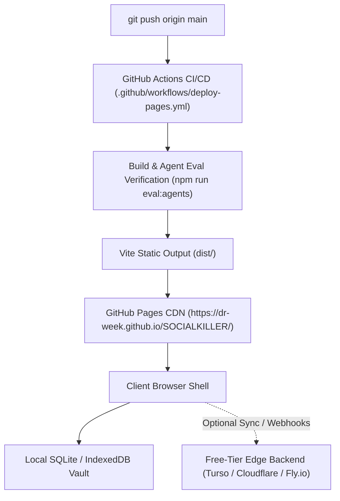

# GitHub Deployment & Free-Tier Backend Strategy

This blueprint documents the production deployment architecture for **SOCIALKILLER**, detailing GitHub-native hosting, free-tier cloud backends, serverless vs. self-hosted trade-offs, and zero-dollar operating cost management.

---

## 1. GitHub Deployment Architecture

SOCIALKILLER is designed to be completely runnable and deployable directly through GitHub.

### GitHub Pages Setup
- **Workflow File:** [`.github/workflows/deploy-pages.yml`](../../.github/workflows/deploy-pages.yml)
- **Vite Base Configuration:** `base: './'` in [`vite.config.ts`](../../vite.config.ts) guarantees relative asset resolution (`./assets/...`), preventing 404 errors under repository subpaths (`https://<owner>.github.io/<repo>/`).
- **Asset Links:** Favicon and public images use relative paths (`./branding/favicon.png`).
- **Client Fallback:** If the local Node.js server (`4174`) is unreachable (e.g. running purely on GitHub Pages without local daemon), the application defaults to client-side offline storage (IndexedDB / WASM SQLite) without breaking navigation or UI features.

---

## 2. Free-Tier Backend, Database & API Hosting Matrix

To maintain the **Anti-Agency / Zero-Middleman** philosophy, the cloud backend must cost **\$0.00/month** for creators.

| Provider | Service Type | Free-Tier Allocation | Cold Start | Best Use Case in SOCIALKILLER |
|---|---|---|---|---|
| **Turso (libSQL)** | Edge SQLite Database | **9 GB storage, 500 databases, 1B row reads/mo** | **0 ms** (sub-10ms query) | **Primary Cloud Sync.** Drop-in replacement for SQLite WAL. Allows multi-device brand sync without re-architecting queries. |
| **Cloudflare Workers** | Edge Serverless Compute | **100,000 requests/day, 10ms CPU time/req** | **< 5 ms** | Webhook intake (Meta/Instagram leads, Stripe notifications) & OAuth token exchange. |
| **Cloudflare D1 & R2** | Edge SQL & Object Storage | **D1: 5 GB storage, 5M reads/day · R2: 10 GB storage, \$0 egress fees** | **0 ms** | Storing creator video scripts, campaign asset exports, and WebP media cards. |
| **Supabase** | Managed PostgreSQL + Auth | **500 MB database, 50,000 monthly active users, 2 projects** | **0 ms** (active) | Team collaboration / multi-seat client portal access. |
| **Fly.io** | Lightweight Container Hosting | **3 shared-cpu-1x 256MB VMs, 3GB volume** | **0 ms** (always-on) | Running the existing Node.js background scheduler (`server.mjs`) 24/7 in the cloud. |
| **Render** | Free Web Service | **750 free instance hours/month** | 50s (spins down after 15m idle) | Secondary backup API; requires client-side keep-alive ping. |
| **GitHub Actions** | Automation & Scheduled Runners | **2,000 free minutes/month (public repos: unlimited)** | ~15s spin-up | Scheduled publishing cron dispatcher (`social-broadcast.yml`) and automated daily regression runs. |

---

## 3. Serverless vs. Self-Hosted vs. Local-First Hybrid

### Option A: Pure Serverless (Cloudflare Workers + Turso)
- **Pros:** 100% free forever, global edge latency (<15ms), zero server management, auto-scaling.
- **Cons:** Node.js native binary restrictions (no native sharp/C++ modules without WebAssembly).
- **Suitability:** High for API routing, auth, and database sync.

### Option B: Self-Hosted Cloud VM (Fly.io / Oracle Cloud Free Tier)
- **Pros:** Full Node.js ecosystem, SQLite WAL file persistence, Chromium headless for Visual Bot.
- **Cons:** Memory management within 256MB-1GB limits, manual setup.
- **Suitability:** Ideal for background social media scheduled dispatchers.

### Option C: The SOCIALKILLER Hybrid (Recommended & Implemented)
1. **Local-First Default:** Everything runs locally on the creator's laptop/desktop (`http://localhost:5199` + `http://localhost:4174`). Data remains 100% private in local SQLite WAL (`.data/social-base.db`).
2. **GitHub Deployment:** Static UI deployed on GitHub Pages as a web app companion.
3. **Turso libSQL Cloud Replication:** Optional encrypted replica for creators who want sync across laptop and mobile without paying for hosted databases.
4. **GitHub Actions Dispatcher:** Automated cron runs `scripts/social/index.ts` using repository secrets for zero-cost unattended publishing.

---

## 4. Free-Tier Limitations & Mitigation Strategy

1. **Rate Limiting (HTTP 429):**
   - *Mitigation:* The Agent Harness enforces an offline queue policy (`scripts/agent-eval/scenarios/advanced-orchestration-scenarios.mjs`). If edge calls exceed free quotas, drafts buffer to local SQLite WAL with automated retry on exponential backoff.
2. **Cold Starts (Render / Lambda):**
   - *Mitigation:* We prioritize Turso and Cloudflare Workers (both <5ms cold start) over traditional containers. For Render, an automated healthcheck ping runs prior to user interaction.
3. **Database Storage Caps (9GB Turso / 500MB Supabase):**
   - *Mitigation:* Media binaries are never stored as raw BLOBs in the SQL database. Large video and image assets are converted to deterministic WebP variants and stored on Cloudflare R2 (10GB free, zero egress) or retained locally in the OS filesystem.
4. **Secret Security on GitHub:**
   - *Mitigation:* Client bundles are strictly checked during evaluation to guarantee private keys (`FOLLOWDESK_VAULT_KEY`, Meta App Secrets) are never bundled into client-side JS (`deployment-secret-sanitization-guard`).
