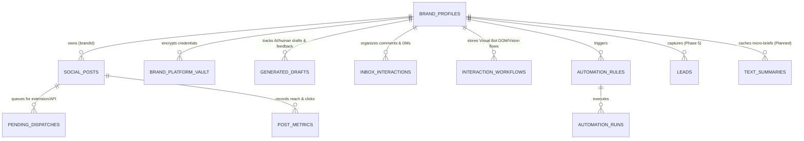

# SOCIALKILLER Database System Architecture & Purpose Blueprint

**Reviewed:** 2026-11-19  
**Engine:** Zero-dependency Node built-in `node:sqlite` (`DatabaseSync` in `server/db/sqlite-engine.mjs`) + Browser `localStorage` cache (`src/composables/useDatabaseManagement.ts`).  
**Storage Path:** `.data/followdesk.sqlite` (WAL mode, foreign keys enforced, `busy_timeout = 5000`).  
**Modular Rule:** Every schema, statement, and repository module in `server/db/` is strictly kept under `<100–150` lines.

---

## 1. Core Purpose of the Database System

Why does **SOCIALKILLER** run an embedded, zero-cloud SQLite + AES-256-GCM database on the creator's own machine?

1. **Zero SaaS Rent / 100% Creator Margin:**
   - Traditional social agencies and SaaS middlemen charge $99–$499/month per brand workspace just to store scheduled posts, CRM leads, and follower snapshots in their cloud database.
   - SOCIALKILLER stores unlimited client brands, audience snapshots, drafts, leads, and automation histories locally on disk for **₹0 / $0**.
2. **Total Data Sovereignty & Privacy:**
   - Client OAuth tokens, API keys, and webhook URLs never leave the creator's workstation. They are encrypted at rest using **AES-256-GCM** (`server/credentials/credential-vault.mjs`) inside `brand_platform_vault`.
3. **Sub-Millisecond Queries for UI & `CLI-Anything` Agents:**
   - Prepared SQLite statements (`server/db/statements.mjs`) in Write-Ahead Logging (`WAL`) mode allow the Vue UI, the MV3 Browser Extension, and the `CLI-Anything` agent harness (`npm run cli-anything`) to read and write concurrently with `<1ms` latency.

---

## 2. Entity-Relationship & Domain Ownership Architecture

---

## 3. Current 4-Pillar Schema Inventory (`server/db/`)

All existing files in `server/db/` comply with Rule #1 (`<150` lines):

| Module | Lines | Domain Purpose & Tables Owned |
|---|---:|---|
| [`sqlite-engine.mjs`](../../server/db/sqlite-engine.mjs) | 56 | Opens `.data/followdesk.sqlite`, configures `WAL` + `foreign_keys`, runs non-destructive additive migrations, and exports `dbService`. |
| [`schema-workspaces.mjs`](../../server/db/schema-workspaces.mjs) | 78 | **Pillar 1 — Multi-Brand Workspaces & Security:** `brand_profiles`, `brand_platform_vault` (AES-256-GCM per brand/platform), `interaction_workflows` (Visual Bot recorded steps), `generated_drafts` (deduplication & thumbs-up/down RL feedback), `inbox_interactions`. |
| [`schema-social.mjs`](../../server/db/schema-social.mjs) | 112 | **Pillar 2 — Publishing, Audience & Idempotency:** `social_posts`, `activity_logs`, `pending_dispatches` (extension bridge queue), `synced_accounts` (Instagram follower/following snapshots), `post_metrics`, `idempotency_tokens` (prevents double-posting), `scheduler_state`, `user_topics`, `dynamic_dictionary`. |
| [`schema-automation.mjs`](../../server/db/schema-automation.mjs) | 40 | **Pillar 3 — Local Automation Engine:** `automation_rules` (`triggerType`, `conditionsJson`, `actionsJson`, `elseActionsJson`, kill-switch `enabled`), `automation_runs` (execution audit trail). |
| [`statements.mjs`](../../server/db/statements.mjs) | 128 | Pre-compiled SQLite prepared statements for O(1) query execution. *(Note: as new tables are added, split into `statements/social-statements.mjs`, `statements/workspace-statements.mjs`, and `statements/crm-statements.mjs` to stay well below 140 lines).* |
| [`repositories/*.mjs`](../../server/db/repositories/index.mjs) | 18–95 | 6 focused repository modules (`publishing`, `brand-profile`, `generated-draft`, `scheduler-state`, `user-topic`, `vault-dictionary`) keeping SQL out of HTTP routes. |

---

## 4. Planned Database Upgrades (Solo-Agency Expansion)

To turn one creative worker into a full-stack agency replacement without violating the `<100–150` line file limit, the database will expand via modular schema and repository slices:

### A. Pillar 4 — Solo-Agency CRM, Client Approvals & Projects (`server/db/schema-agency-crm.mjs` — `<100` lines)
1. **`leads` Table (Phase 5 — Comment-to-Lead & DM Pipeline):**
   - Columns: `id`, `brandId`, `contactName`, `handle`, `platformId`, `source`, `triggerWord`, `message`, `email`, `phone`, `intent` (`hot_lead` | `inquiry` | `collab`), `status` (`new` → `contacted` → `qualified` → `proposal` → `won`), `notes`, `createdAt`, `updatedAt`.
   - Purpose: Automatically converts high-intent comments/DMs (`"PRICE"`, `"HIRE"`, `"COLLAB"`) into trackable client revenue without paying for HubSpot or Salesforce.
2. **`client_deliverables` & `approval_checkpoints` Table (Phase 6 & 7):**
   - Columns: `id`, `brandId`, `projectId`, `title`, `period`, `status` (`draft` | `in_review` | `approved` | `delivered`), `reviewerNotes`, `dueAt`, `updatedAt`.
   - Purpose: Tracks monthly retainer deliverables (e.g., *"12 Reels, 8 Carousels, 4 X Threads"*) and human sign-off history so solo creators can prove ROI to clients instantly.

### B. Pillar 5 — Visual Bot Locator Cache & Text Summary Vault (`server/db/schema-visual-bot.mjs` — `<90` lines)
1. **`visual_bot_locators` Table (`Midscene` / `Stagehand` Pattern):**
   - Columns: `id`, `origin`, `elementRole`, `semanticLabel`, `cachedSelector`, `sobelTemplateId`, `lastVerifiedAt`, `successCount`, `failCount`.
   - Purpose: Caches verified DOM/Accessibility selectors and Sobel edge bounding-box coordinates per website origin so the Browser Extension & Visual Bot replay workflows in `<50ms` and self-heal when social sites change CSS class names.
2. **`content_summaries` Table (Text Summarization & Micro-Brief Cache):**
   - Columns: `id`, `brandId`, `sourceUrl`, `sourceHash`, `originalWordCount`, `tldr`, `bulletsJson`, `channelBriefsJson`, `createdAt`.
   - Purpose: Persists compressed TL;DRs and platform hooks generated by `src/domain/text-summarizer.ts` and harvested threads from the extension (`page-harvester.js`) for instant reuse in Composer and Script Studio.

### C. Statement & Backup Modularization Rules
1. **Split `statements.mjs` (`128` lines) by Pillar:**
   - Before adding CRM or Visual Bot queries, split `server/db/statements.mjs` into:
     - `server/db/statements/publishing-statements.mjs` (`<70` lines)
     - `server/db/statements/workspace-statements.mjs` (`<70` lines)
     - `server/db/statements/agency-crm-statements.mjs` (`<70` lines)
2. **Unified Portable Snapshot (`.socialkiller.backup.json` / SQLite Backup):**
   - Upgrade backup/restore so creators can export a single encrypted or workspace-scoped archive containing both their browser audience snapshots and their SQLite brand/campaign history.
