# Phased Development Roadmap & Architecture Evolution

This roadmap establishes the phased development strategy for **SOCIALKILLER**, balancing immediate creator utility with advanced AI agent capabilities and zero-cost cloud architecture.

---

## 1. Phase Overview

```mermaid
flowchart LR
  P0["Phase 0: Foundation & Verification"] --> P1["Phase 1: Responsive UI & Pruning"]
  P1 --> P2["Phase 2: Unified Mini-Apps & Launcher"]
  P2 --> P3["Phase 3: Social Studio & Scheduler"]
  P3 --> P4["Phase 4: AI Inbox & Safe Reply"]
  P4 --> P5["Phase 5: Leads CRM & Pipeline"]
  P5 --> P6["Phase 6: Client Portal & Approvals"]
  P6 --> P7["Phase 7: Advanced Projects & Optimization"]
```

---

## 2. Detailed Phase Specifications

### Phase 0: Foundation, Verification & Edge Harness (Active / Baseline)
- [x] Establish single-truth local SQLite WAL engine (`server/db/`)
- [x] Implement 3-Layer Visual Bot (CLI-Anything, Accessibility DOM, Sobel 2D NCC Vision)
- [x] Implement 31-scenario AI Agent Evaluation Harness with baseline diffing (`scripts/agent-eval/`)
- [x] Create GitHub Actions Pages deployment workflow (`.github/workflows/deploy-pages.yml`)
- [x] Cross-platform runtime identity and port arbiter verification (`scripts/runtime/`)

### Phase 1: Responsive Hygiene & Modular Boundaries
- [x] Enforce strict `<150` line limit across TypeScript and SCSS components
- [x] Remove legacy subtabs and dead code; establish compact status pills
- [x] Add explicit draft lifecycle (`draft` → `scheduled` → `published` → `failed`)
- [ ] Complete 5-width responsive audit (360px, 390px, 768px, 1024px, 1280px)

### Phase 2: Unified Mini-App Shell & Workspace Context
- [x] Centralized app launcher with synchronized brand profile context
- [x] In-tab seamless routing with browser history and direct deep-linking
- [x] Dedicated workspaces for Script Studio, Content Studio, Audience Audit, and Connections
- [ ] Polish keyboard shortcuts (`Cmd/Ctrl + K` global launcher and navigation)

### Phase 3: Multi-Platform Social Studio & Combinatorial Publishing
- [ ] Multi-framework caption engine:
  - *Hook-Story-Offer* (conversion)
  - *Short & Punchy* (viral tech reach)
  - *Educational Carousel* (slide-by-slide Instagram/LinkedIn)
- [ ] Quantum-inspired simulated annealing scheduler to eliminate cross-channel post collisions
- [ ] Visual Instagram grid preview and media card composer
- [ ] Safe human approval gate before live API dispatch

### Phase 4: Conversational Inbox & AI Engagement Agent
- [ ] 3-Pane Inbox: Conversation List · Thread View · Action Inspector
- [ ] Intent classification: 🔥 Hot Lead, ❓ Inquiry, ⚠️ Complaint, ⭐ Praise
- [ ] Human-in-the-loop AI reply draft suggestions (zero unattended direct sends)
- [ ] 1-Click "Convert to Lead" button auto-populating CRM contact card

### Phase 5: Solo Creator CRM & Automated Lead Pipeline
- [ ] `leads` SQLite table with custom brand attribution
- [ ] Interactive Kanban Pipeline: `new → contacted → qualified → proposal → won`
- [ ] Automatic keyword triggers from social comments (e.g. `PRICE`, `DEMO`, `HIRE`)
- [ ] 1-Click CSV export and Google Sheets sync integration

### Phase 6: Client Management & Transparent Client Portal
- [ ] Client brand workspace profiles (voice guidelines, restricted terms, design assets)
- [ ] Deliverables status board and weekly milestone tracker
- [ ] Shareable read-only client review link (approve, request edits, leave feedback)
- [ ] Proof-of-performance automated analytics reports

### Phase 7: Dev/Design Projects & Advanced Algorithmic Optimization
- [ ] Structured project sprint board (`Brief → Design → Dev → Review → Shipped`)
- [ ] Advanced Graph Partitioning for audience clustering and collaborator discovery
- [ ] Cloud Turso libSQL encrypted sync for multi-device creators
- [ ] Full Capacitor Android AAB build automation via GitHub Actions

---

## 3. Measurable Success Criteria & Quality Gates

1. **AI Agent Eval Gate:** 100% of scenarios in `npm run eval:agents` must pass with P95 latency `< 25ms`.
2. **File Size Law:** Zero files above 149 lines in modern feature directories (`scripts/check-file-size.mjs`).
3. **Security Gate:** Zero secret leakage in client builds; all credentials encrypted with AES-256-GCM.
4. **Operating Cost:** Total creator infrastructure cost strictly maintained at **\$0.00/month**.
